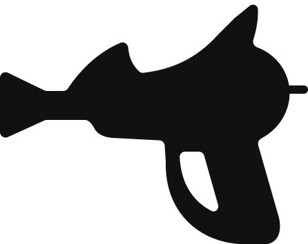

<p align="center">
  
</p>

<h1 align="center">Raygun</h1>

<h3 align="center">Your photos. Your pixels. Your machine. Now with zap.</h3>

<p align="center">
  <b>Fast photo library + non-destructive RAW developer in pure Rust.</b><br>
  LightCraft UI reused verbatim. RapidRAW features land as modes of existing tools. Desktop first, WASM-compatible.
</p>

<p align="center">
  
  
  
  
  
  <a href="ROADMAP.md"></a>
</p>

<p align="center">
  
</p>

## What this is

Raygun merges two proven open-source bases:

- **LightCraft** (`https://github.com/storytold/lightcraft`) — pure-Rust library, develop pipeline, GPU `wgpu` CPU-exact rendering, command registry, MCP/CLI/control channel. Its `crates/ui-egui` is reused verbatim.
- **RapidRAW** (`https://github.com/CyberTimon/RapidRAW`) — feature reference for tone science, masking/AI workflow, film/LUT handling, culling/library polish. Ported as modes of existing Raygun tools, not separate panels. No direct code copy until each dependency license (`rawler`, `lensfun`, `ort`, models) is cleared in `AGENTS.md`.

License: **AGPL-3.0-or-later** (see `LICENSE`). Upstream MIT/Apache notices retained in `LICENSE-MIT`, `LICENSE-APACHE`, `NOTICE`.

## Quick start

```sh
cargo run --release -p lightcraft -- --memory   # throwaway demo session (binary rename to raygun lands in Phase 1)
cargo run --release -p lightcraft -- ~/Pictures/trip
cargo run --release -p lightcraft -- --control 7980
cargo xtask ci                                  # fmt, clippy, tests, layers, assets, wasm
```

Rust 1.90+ required (repo pins `1.90`; CI/dev machine here runs `1.99.0`).

## Project boards

- Roadmap: [`ROADMAP.md`](ROADMAP.md) — phases, Top Gaps, WASM rules.
- Parity tracker: [`docs/parity.md`](docs/parity.md) — one row per Lightroom feature/menu/shortcut.
- Agent loop: [`tools/agent-loop/`](tools/agent-loop/) — `loop.ps1` runs check → fix → review passes until green.

## Repo map

`geom`, `color`, `raster`, `tiff` → `raw`, `codecs`, `meta`, `develop` → `pipeline` → `catalog` → `engine` → `ui-egui`, `mcp` → apps `lightcraft` (to be renamed `raygun`), `lightcraft-cli`, `lightcraft-web`.

## Branding

- Vector mark: [`assets/raygun.svg`](assets/raygun.svg) (user-supplied original, AGPL).
- White-frame PNG app icon (1024/512/256/…): tracked follow-up — export from the SVG via `packaging/icons.sh` + `cargo xtask ico`, then register under `assets/app-icon/`.
- No Adobe assets ever. Every asset needs an `assets/ATTRIBUTION.md` row in the same commit (`cargo xtask assets` enforces it).
